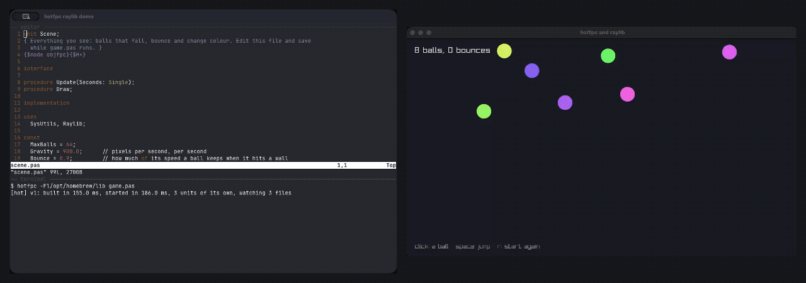

# hotfpc

Hot reloading for Free Pascal. Save a unit while your program runs, and the program carries
on with the new code and everything it had: its variables, objects, open files and threads.
If an edit changes something the running program depends on, such as a variable's size,
hotfpc names the declaration in the way and starts the program over.

```sh
brew install fpc frostney/tap/hotfpc
```

Homebrew covers macOS on Apple silicon and Linux on x86-64. For Windows, an Intel Mac,
Linux arm64 or a build from source, see [Install](#install). The documentation is at
<https://frostney.github.io/hotfpc/>, rendered from [docs/](docs/index.md).


This is a real run of [`examples/demo`](examples/demo) on macOS arm64 with fpc 3.2.2
([video](docs/demo.mp4), [asciinema cast](docs/demo.cast)), recorded in tmux. On the right,
a shell runs `hotfpc --log hot.log demo.pas`, and the program's output and hotfpc's `[hot]`
lines appear there. On the left, `scene.pas` is open in vim, and four edits get typed in and
saved with `:w`.

hotfpc's own timings from `hot.log` run below vim. They show how long each save took to
swap, and how much of that went to settling, compiling, the interface check and loading into
the program.

The first three edits change a character, a step size and a colour. Each one is swapped in
about 100 ms after the save, and the score keeps counting from where it was. The fourth
turns the score from an `Integer` into an `Int64`. A running program can't change the size
of a variable it already has, so hotfpc starts the program over with the new code, about a
second after the save, and the score starts again from zero.

[`scripts/record-demo.py`](scripts/record-demo.py) types every keystroke into the shell and
vim with `tmux send-keys`.

## Use

### Your program

Put `hotfpc` in front of your fpc command line:

```sh
hotfpc -Fusrc -dDEBUG src/server.pas -- --port 8080
```

hotfpc builds the program with your fpc, starts it and watches its sources. Leave it
running, edit a unit and save. Every save ends in one of these:

- `vN swapped`: the new code runs from the next call on, and the program keeps its state.
- `restart needed: ...` and `vN restarted`: the edit changes something the running state
  depends on. hotfpc names the declaration and starts the program over with the new code.
- `not swapped`: the source changed but the generated code didn't.
- `error: ... (nothing changed)`: the unit doesn't compile, and you get fpc's errors. The
  program keeps running the code it had.

Keep the code you want to change in units: the main program's block is already running.
[Your own program](docs/guides/your-program.md) has the options and what hotfpc watches,
and [what a save does](docs/guides/saves-and-restarts.md) has every case.

### With lwpt

hotfpc passes [lwpt](https://github.com/frostney/lwpt)'s `lwpt.cfg` to fpc and watches every
directory in it, so a run task starts your package under hotfpc and edits to dependencies
are swapped in too:

```toml
[hot]
command = "hotfpc"
args = ["@lwpt.cfg", "source/greeter.pas"]
```

See [with lwpt](docs/guides/lwpt.md) and [`examples/lwpt`](examples/lwpt).

### With raylib



This is a real run of [`examples/raylib`](examples/raylib) on macOS arm64 with Homebrew's
fpc 3.2.2 and raylib ([video](docs/raylib-demo.mp4)), recorded on 25 Nov 2026 with hotfpc
built from commit `0cbf4ea` ([pull request #24](https://github.com/frostney/hotfpc/pull/24)),
which reports version 1.1.0. The terminal on the left runs tmux, with `scene.pas` open in
vim above and a shell below that runs `hotfpc -Fl/opt/homebrew/lib game.pas`. The game
window is on the right: balls that fall, bounce and change colour, with a count of bounces
at the top.

Five edits to `scene.pas` get saved while the game runs:

1. `Bounce = 0.9` to `1.0`: the balls keep all their speed when they hit a wall.
2. `Gravity = 900.0` to `500.0`: they fall more slowly and rise higher.
3. `ClearBackground(Color(24, 26, 34))` to `Color(46, 30, 70)`: the background turns
   purple.
4. `DrawCircleV(Balls[I].Position, Radius, ...)` to
   `DrawPoly(Balls[I].Position, 6, Radius, Balls[I].Hue, ...)`: the balls become hexagons,
   turned by their hue, so they spin as their colour changes.
5. `MaxBalls = 64` to `128`: room for more balls.

The first four are swapped in 96 to 109 ms after hotfpc saw the save (`v2` to `v5`). The
balls carry on from where they were, and the count of bounces keeps going. The fifth
changes the size of `Balls`, which a swap can't do to a variable the program already has,
so hotfpc prints `restart needed: scene.Balls` and starts the game over with the new code.
It reports `v6 restarted` 479 ms after it saw that save. The game begins again with its
first balls, with all five edits in it.

[With raylib](docs/guides/raylib.md) shows how to get raylib, run the example and lay out a
game for hot reloading.

## Install

You need Free Pascal 3.2.2 or later; hotfpc checks the version when it starts.

- **Homebrew**, on macOS on Apple silicon and Linux on x86-64:
  `brew install fpc frostney/tap/hotfpc`.
- **A release archive** from the [releases](https://github.com/frostney/hotfpc/releases),
  with a checksum file. Release 1.1.0 has macOS arm64, Linux x86-64 and Windows x86-64;
  the releases after it also have macOS x86-64 and Linux arm64.
- **From source**: `./build.sh hotfpc` builds `build/hotfpc`, and
  `build.bat hotfpc -- -Twin64 -Px86_64` builds a 64-bit `build\hotfpc.exe` on Windows. It's
  plain Pascal and needs nothing beyond fpc.

The [quick start](docs/guides/quick-start.md) has each way step by step, and
[platforms](docs/reference/platforms.md) has what runs where and what was tested.

## Why there's an agent

Free Pascal has no way to replace code in a running program, so hotfpc compiles a small
unit into your program with fpc's `-Fa` option: the agent. On every save, it loads the new
code, binds it to the variables the program already has and points the old routines at it.
You don't change your source for it. hotfpc carries the agent's source and compiles it with
your fpc and options, so one hotfpc works with every fpc from 3.2.2 on, and with
cross-compiled programs such as a Windows program built on Linux.
[The introduction](docs/guides/introduction.md) explains why, and
[how it works](docs/internals/how-it-works.md) explains how.

Build what you ship with plain fpc: a program built by hotfpc carries the agent and keeps
its symbols.

## Documentation

- [Guides](docs/index.md#guides): introduction, quick start, what a save does, your own
  program, edits and what they do, lwpt, raylib, Windows, troubleshooting.
- [Reference](docs/index.md#reference): command line, output, environment variables,
  platforms, limits.
- [Contributing](docs/index.md#contributing): how it works, build system, code style,
  tooling, testing, releasing.

## Contributing

Changes are welcome: build with `./build.sh`, and test with the unit tests and the
scenarios. See [CONTRIBUTING.md](CONTRIBUTING.md) and, for agents, [AGENTS.md](AGENTS.md).

## Licence

MIT, see [LICENSE](LICENSE).
