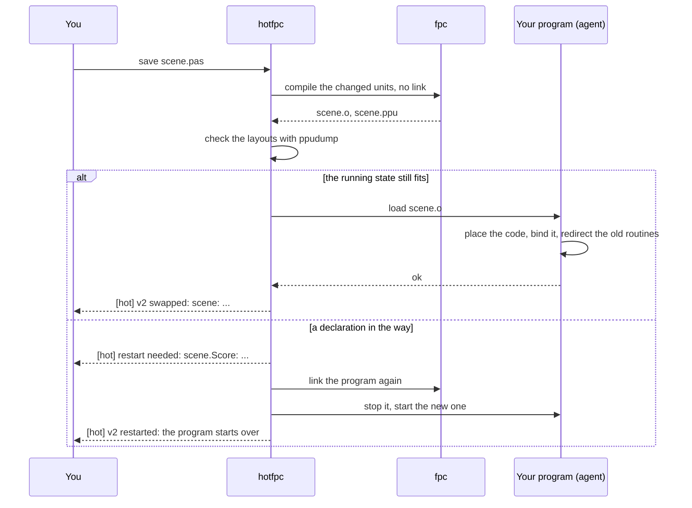

# Introduction

**Hot reloading for Free Pascal programmers.** What hotfpc does to your program, what
survives a save and what doesn't, and why it works the way it does. No knowledge of
linkers or object files assumed.

## What hot reloading is

You run your program under hotfpc instead of building and starting it yourself:

```sh
hotfpc game.pas
```

hotfpc builds the program with your fpc and starts it. Then you edit a unit and save. A
moment later the running program calls the new code, and everything it had stays as it
was: its variables, the objects on the heap, open files and windows, running threads,
where the player stood. You see the change without rebuilding, restarting and finding your
way back to where you were.

That pays off most in programs that run for a while and build up state: games, servers,
simulations, tools with a long setup, and anything you tune by eye.

hotfpc wraps fpc and nothing else. You don't need a build tool or a C compiler, and you
don't change your program for it. It's a single program written in Pascal.

## Swap or restart

Every save ends in one of two ways when it compiles:

- **A swap.** The new code takes over from the next call on. The program keeps its state.
  Most edits to the body of a routine, a constant or an expression are swaps.
- **A restart.** Some edits change what the running program's state is made of: a
  variable's size or type, a record's fields, a class's fields or virtual methods, a new
  unit. The old state can't be used with the new code, so hotfpc names the declaration in
  the way and starts the program over with the new code, like a browser reloading a page.

A save that doesn't compile changes nothing: you get fpc's errors, and the program keeps
running the code it had. [What a save does](saves-and-restarts.md) has every case.

## The agent

Free Pascal has no way to replace code in a running program. There's no run-time linker
for units, and shared libraries only help if you write your program around them, with the
code to reload in a library and its state somewhere else. hotfpc is for the program you
already have.

So hotfpc puts a small unit into your program when it builds it: **the agent**. It is
Pascal, compiled by your fpc with your options, and loaded before your own units with
fpc's `-Fa` option. You don't change your source for it. On every save, the agent loads the
newly compiled code into the program, binds it to the variables the program already has,
and points the old routines at the new ones. It works from inside the program because the
program can rewrite its own code with ordinary calls on every system, where another
process often isn't allowed to: macOS signs a program's code, and Linux often restricts
ptrace.

hotfpc carries the agent's source in its own binary and compiles it when it starts, with
the same fpc and target options as your program. That is why one hotfpc works with every
fpc from 3.2.2 on, and with a Windows program cross-compiled on Linux.

## One save, end to end



A swap usually takes 40 to 150 ms from save to running, most of it fpc compiling the unit.
[How it works](../internals/how-it-works.md) explains every step.

## What you ship

hotfpc is for development. Build what you ship with plain fpc: a program built by hotfpc
carries the agent and keeps its symbols, which you don't want in a release. hotfpc builds
into `.hot/` next to your program's source and leaves your own build alone.

## Where to go next

- [Quick start](quick-start.md): install hotfpc and watch the demo program swap and
  restart.
- [Your own program](your-program.md): the options, the files hotfpc watches, and how to
  lay out code you want to change.
- [Edits and what they do](edits.md): every kind of edit, with the test that shows it.
