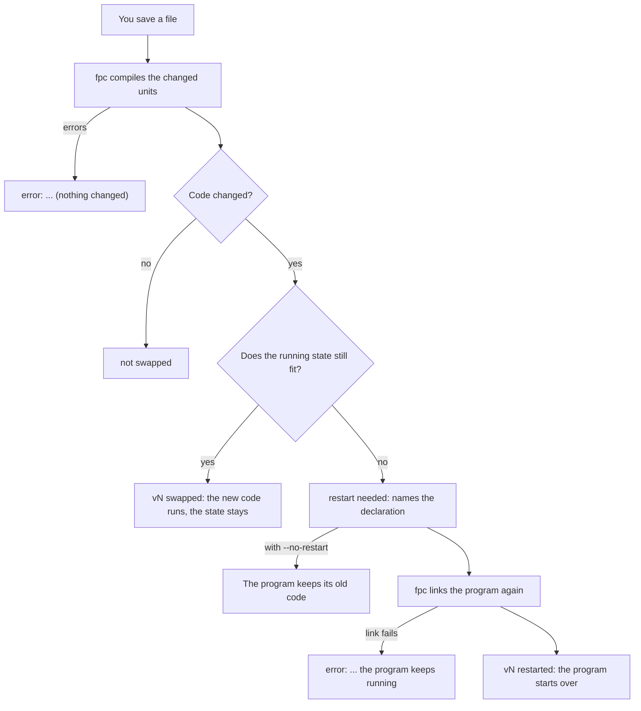

# What a save does

When you save a watched file, hotfpc waits for the file to stop changing, compiles what
changed without linking, checks it against the running program, and then swaps it in, or
starts the program over, or tells you why it did neither. This page says which edits end
which way and what happens to the program's state. The exact lines are in
[Output](../reference/output.md); every kind of edit, with the test that shows it, is in
[Edits and what they do](edits.md).

## What a swap keeps

A swap changes code, not state:

- **Variables keep their values and addresses**, in the interface and the implementation
  section alike. New code reads and writes the same variables the old code did.
- **Routines keep their addresses.** The old entry of each changed routine jumps to the new
  code, so procedure variables, method pointers, `@Proc` values and virtual method tables
  taken before the swap call the new code.
- **Objects stay valid.** An object that old code made works with new code: its class and
  virtual method table are the same ones, updated in place.
- **Constants and literals are new.** The new code uses its own, so a changed `const`
  takes effect at once.
- **A changed initial value** (`Speed: Integer = 5` to `= 50`) is applied when the
  variable still holds the old initial value, byte for byte, and neither value holds an
  address, such as a pointer, a `PChar` or a string. Otherwise it keeps the value it has.
  hotfpc compares values, not writes: a variable the program changed and then set back to
  its initial value gets the new one. hotfpc notes which it was.
- **Threads keep running.** The agent stops the program's other threads for the few
  microseconds the writes take.

The main program's block is already running, so it keeps its old code (hotfpc notes it),
and so does a routine that is running at the moment of the swap until it returns: the new
code runs from the next call on. A unit's initialization section isn't run again. Put the
code you want to change in routines in units, and call them from the main block.

## What needs a restart

An edit needs a restart when the program's state depends on what it changes:

- a variable's size or type, also when the size stays the same (`Integer` to `Single`);
- a record's or class's layout: a field added, removed, moved or retyped;
- a class's virtual methods (its virtual method table), or its parent class;
- a new unit of the program's own, or a renamed one;
- a new thread variable, or one that changed size;
- a routine the running program doesn't contain: from a unit of the runtime it wasn't
  linked with (`uses Math` when nothing used it), or on Windows any runtime routine the
  program never called, because fpc's Windows linker leaves those out.

hotfpc names the declaration in the way, such as `scene.Score: the declaration changed its
layout or type`, and then starts the program over.

## What a restart does

1. fpc links the program again, into `.hot/next/`. If the link fails, you get its errors,
   and the program keeps running the code it had.
2. hotfpc stops the program the way the system ends a process: `SIGTERM` and then
   `SIGKILL` on Linux and macOS, `TerminateProcess` on Windows. Its state is gone, and its
   finalization sections don't run.
3. It starts the new program with the same arguments and environment, and its output goes
   on in the same terminal. The next save is swapped into the new program.

A restart takes the time of a link and a start: 360 to 500 ms in the scenarios on Linux
x86-64.

With `--no-restart`, hotfpc prints the `restart needed` line and leaves the program running
its old code. Later saves that can be swapped are swapped. To get the edit in, stop hotfpc
and start it again.

### When a restarted program fails

A program that a restart started can fail where the first one didn't, such as with a
runtime error in an initialization section you just edited. That doesn't end hotfpc: it
says so, and the next save that builds starts the program again. So you fix the error,
save, and carry on.

A restarted program that ends with exit code 0, and the first program however it ends,
end hotfpc, which ends with the program's exit code.

## Saves that change nothing

- **A save that doesn't compile.** You get fpc's errors, at most six, as `[hot] error:`
  lines, and the program keeps running the code it had. Fix it and save again.
- **A save that doesn't change the code**, such as a comment: `not swapped: the generated
  code is the same`.
- **A save to a file hotfpc doesn't watch.** Nothing happens. See
  [Your own program](your-program.md#what-hotfpc-watches).

Several saves in quick succession can be compiled together, and hotfpc acts on the newest
text. A save that lands while fpc is compiling, such as the second file of a "save all" or
the next save, makes hotfpc set that compile aside and compile again once the files settle,
so it doesn't swap or report a mix of old and new files. That holds for three compiles in a
row, and hotfpc waits a second at most for the files to settle before each. A file that
keeps changing faster than fpc compiles, such as one a generator keeps rewriting, can't hold
a save back longer: the fourth compile is used as it is, even when a file changed while fpc
read it, so what it swaps or reports can mix old and new text. On Windows, a save whose
variables with initial values hotfpc checks needs a restart then instead. Save again once
the files have stopped changing
([how it works](../internals/how-it-works.md#one-save)).
