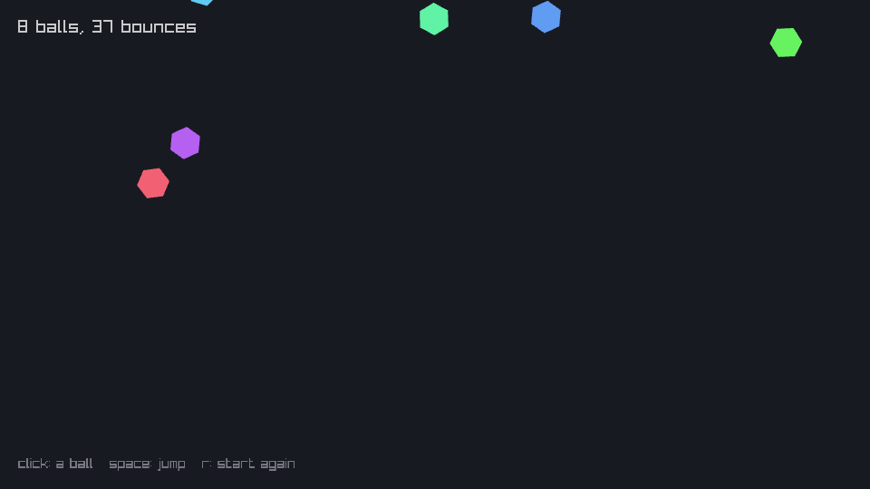

# raylib

A small [raylib](https://www.raylib.com) program to play with: balls that fall, bounce and
change colour. `game.pas` opens the window and runs the frame loop, and everything you see
comes from `scene.pas`. Edit that while it runs.

`raylib.pas` declares the part of raylib the example uses, straight from `raylib.h`, so
there are no bindings to install. If you want another function, copy its line from
`raylib.h` into it.

## Get raylib

- **macOS:** `brew install raylib`.
- **Linux:** download `raylib-<version>_linux_amd64.tar.gz` from raylib's
  [releases](https://github.com/raysan5/raylib/releases) and unpack it anywhere. Your
  distribution's package works too, if it has one.
- **Windows:** download `raylib-<version>_win64_mingw-w64.zip` from the same page and copy
  `lib/raylib.dll` into this directory.

The example was written against raylib 6.2.

## Run it

```sh
cd examples/raylib
hotfpc -Fl/opt/homebrew/lib game.pas                       # macOS with Homebrew
hotfpc -Fl$RAYLIB/lib -k-rpath -k$RAYLIB/lib game.pas      # an unpacked release, macOS or Linux
hotfpc game.pas                                            # Windows, with raylib.dll here
```

`$RAYLIB` is where you unpacked the release. `-Fl` tells fpc where the library is, and
`-k-rpath` tells the program where to find it when it starts.

Click to drop a ball, press space to make them all jump, and r to start again.



That's the game after two saves, one for `Gravity` and one for `DrawPoly`, from a run on
Linux. The count of bounces carried on from before them.

## Things to try

Change any of these in `scene.pas` and save. The balls carry on from where they were:

- `Gravity`, `Bounce` or `HueSpeed`;
- the background in `ClearBackground(Color(24, 26, 34))`;
- `ColorFromHSV(Balls[I].Hue, 0.6, 0.95)`, for paler or darker balls;
- `DrawCircleV(...)` to `DrawPoly(Balls[I].Position, 6, Radius, Balls[I].Hue, ...)`, for
  spinning hexagons;
- the text at the top.

Some edits need a restart. hotfpc says which declaration is in the way and starts the game
over, with a new set of balls:

- `MaxBalls`, because it changes the size of the `Balls` array the program already has;
- a new field in `TBall`, for the same reason.

On Windows, a raylib function that the program didn't call when it started needs a restart
as well. On macOS and Linux, hotfpc looks it up in the library.
