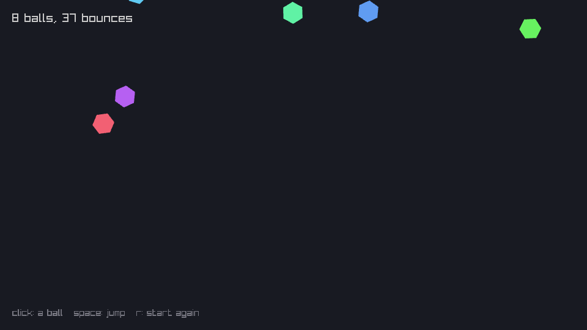

# raylib

A small [raylib](https://www.raylib.com) program to play with: balls that fall, bounce and
change colour. `game.pas` opens the window and runs the frame loop, and everything you see
comes from `scene.pas`. Edit that while it runs.

`raylib.pas` declares the part of raylib the example uses, straight from `raylib.h`, so
there are no bindings to install. If you want another function, copy its line from
`raylib.h` into it.

## Run it

With raylib installed ([how to get it](../../docs/guides/raylib.md#get-raylib)):

```sh
cd examples/raylib
hotfpc -Fl/opt/homebrew/lib game.pas                       # macOS with Homebrew
hotfpc -Fl$RAYLIB/lib -k-rpath -k$RAYLIB/lib game.pas      # an unpacked release, macOS or Linux
hotfpc game.pas                                            # Windows, with raylib.dll here
```

Click to drop a ball, press space to make them all jump, and r to start again. Then change
`Gravity`, the colours or the shapes in `scene.pas` and save: the balls carry on from where
they were. [With raylib](../../docs/guides/raylib.md) lists what to try and which edits
need a restart.



That's the game after two saves, one for `Gravity` and one for `DrawPoly`, from a run on
Linux. The count of bounces carried on from before them.

The [recording in the main README](../../README.md#with-raylib)
([GIF](../../docs/raylib-demo.gif), [video](../../docs/raylib-demo.mp4)) shows four saves
to `scene.pas` swapped into the running game on macOS.
